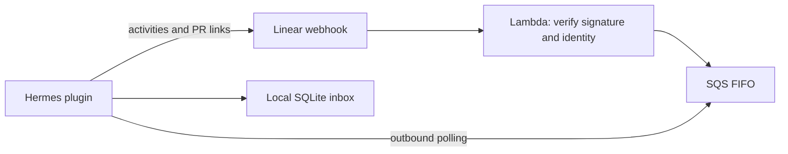

# Linear agent sessions

The optional [Linear example](https://github.com/boldblackai/harness/tree/main/examples/linear) connects a running Hermes gateway to mentions, issue delegations, and follow-up messages in Linear. It uses the upstream Harness image unchanged. It is an opt-in deployment example, not a built-in Harness CLI integration.

The plugin targets the Hermes v0.22.2 APIs shipped in `hermes-1.12.0`. Recheck compatibility before upgrading: session task tracking and final-delivery metadata are internal Hermes interfaces. Unit tests use simulated transports; validate a disposable Linear issue before giving the deployment production work.

## Architecture



The public Lambda Function URL accepts only signed, fresh events for the configured organization and app. The gateway polls SQS outbound; it needs no inbound port. Each Linear session maps to a Hermes session. Explicit Linear user IDs authorize work, follow-ups, status, and Stop signals.

The inbox commits before queue deletion and deduplicates event IDs. Queued work survives restarts. A run that had already started is reported as interrupted, requiring a fresh request rather than replaying potentially completed tool side effects. Run only one consumer against this inbox. Keep `HERMES_HOME` on a local filesystem, such as retained EBS; SQLite WAL must not live on EFS/NFS. Back up the full agent state.

## 1. Configure a Linear app

Create a private app for your workspace with [client credentials enabled](https://linear.app/developers/oauth-2-0-authentication#client-credentials-tokens). Configure it as an agent following [Linear's setup guide](https://linear.app/developers/agents). Record the organization ID and app **user** ID (the latter is not the OAuth client ID).

The plugin requests `read,write,app:assignable,app:mentionable,webhook`. Every other token issuer for this app must use the same scopes: a different scope set invalidates existing app tokens. Tokens stay in memory, renew before expiry, and refresh once on HTTP 401. This example is for one workspace; a public multi-workspace OAuth service needs a separate installation and credential model.

Store the webhook signing secret as an SSM SecureString, for example `/hermes-linear/LINEAR_WEBHOOK_SIGNING_SECRET`. The receiver reads this parameter; the gateway does not need the signing secret. Store the client ID/secret in your gateway's normal secret mechanism. Avoid putting secret values in committed configuration or CloudFormation parameters.

## 2. Deploy the receiver and queue

From a checkout of this repository, render a standalone CloudFormation template:

```bash
python3 examples/linear/render_template.py > /tmp/hermes-linear.json
```

The template creates an encrypted FIFO queue and dead-letter queue, a Lambda receiver and Function URL, and scoped IAM policies. It attaches queue-consumer permissions to an **existing** ECS task role or EC2 instance role. It does not create a gateway, change its networking, or manage its persistent volume. Use a separate stack in the gateway's account and region:

```bash
aws cloudformation deploy \
  --region us-east-1 \
  --stack-name hermes-linear \
  --template-file /tmp/hermes-linear.json \
  --capabilities CAPABILITY_IAM \
  --parameter-overrides \
    GatewayRoleName=YOUR_GATEWAY_ROLE_NAME \
    OrganizationId=YOUR_ORGANIZATION_UUID \
    AppUserId=YOUR_APP_USER_UUID \
    SigningSecretParameter=/hermes-linear/LINEAR_WEBHOOK_SIGNING_SECRET

aws cloudformation describe-stacks --region us-east-1 \
  --stack-name hermes-linear --query 'Stacks[0].Outputs'
```

If the SecureString uses a customer-managed KMS key, also pass `SigningSecretKeyArn=YOUR_KEY_ARN` and ensure its key policy permits the receiver role to decrypt through SSM. Leave it empty for the default `aws/ssm` key. The public Function URL uses HMAC authentication in the handler; it is intentionally not protected by AWS IAM authentication.

Set the app's webhook URL to the `WebhookUrl` output and enable **Agent session events** after the gateway is ready. The receiver checks the raw-body signature, a 60-second timestamp window, and both envelope/session identities before enqueueing. See [Linear webhook verification](https://linear.app/developers/webhooks).

## 3. Install the plugin and configure Hermes

Copy the contents of `examples/linear/plugin/` into the gateway's persisted `$HERMES_HOME/plugins/harness-linear-agent/`. Run the copy as the workload user, or restore ownership to `1000:1000`. The Harness Hermes image includes `boto3` through its Bedrock dependency. Do not install the plugin in the image's ephemeral filesystem.

Merge these keys into the existing `$HERMES_HOME/config.yaml`, preserving other enabled plugins and display settings:

```yaml
plugins:
  enabled:
    - harness-linear-agent
display:
  platforms:
    linear:
      streaming: false
      interim_assistant_messages: true
      tool_progress: 'off'
      show_reasoning: false
      long_running_notifications: false
```

Supply the following gateway environment variables through your existing secret/configuration mechanism:

| Variable | Value |
|---|---|
| `AWS_REGION` | Receiver/queue region, such as `us-east-1` |
| `LINEAR_AGENT_QUEUE_URL` | Stack's `QueueUrl` output |
| `LINEAR_ORGANIZATION_ID` | Same organization UUID as the receiver |
| `LINEAR_APP_USER_ID` | Same app user UUID as the receiver |
| `LINEAR_ALLOWED_USERS` | Comma-separated Linear user UUIDs explicitly allowed to run work; no wildcard |
| `LINEAR_CLIENT_ID` | OAuth app client ID |
| `LINEAR_CLIENT_SECRET` | OAuth app client secret |

Use the gateway's AWS role credentials for SQS. Restart the gateway after installing the plugin or changing configuration. Confirm the plugin loaded and the Linear adapter connected before enabling webhook delivery.

This plugin transports requests and responses; it does not add issue-management tools, repository credentials, or deployment permissions. Configure the Hermes tools appropriate for your workspace separately. Existing Linear MCP authentication is independent; this example does not patch Hermes's MCP OAuth transport. Any additional client-credentials issuer for the same app must keep the scope set above.

## 4. Verify on a disposable issue

Mention or delegate to the app as an allowed user, then reply in the agent session. Verify an acknowledgement, a final response, and a continued conversation. Ordinary ticket text cannot invoke Hermes gateway slash commands; only an authenticated Stop signal takes the control path.

During a longer task, send `/status` or `any updates?`. These standalone requests return recorded progress and queued work without calling a model or waiting for the running task. Mixed requests such as “status, then fix the tests” stay queued as work. Status still depends on healthy queue/API connectivity.

Interim messages carry findings and blockers. The prompt asks the agent to report a verified existing fix immediately, distinguish verification from deployment, and reuse evidence. These are instructions to the model, not guaranteed latency bounds. Temporary liveness activities use Linear's `ephemeral` flag, so repeated heartbeats do not accumulate in the conversation. Public GitHub PR URLs are also attached to the session as external links.

Exercise Stop, a gateway restart during work, and a request from a non-allowlisted user. Verify that interrupted work is not replayed and unauthorized requests do not start a model. Linear expects the webhook response within five seconds and an initial activity within ten seconds; verify these timings in your deployment, including cold starts. A paused consumer or API outage can exceed them.

## Operations and removal

Queue retention is 14 days; after eight failed receipts a message moves to the dead-letter queue. Monitor receiver errors, queue age, and dead-letter messages. Investigate poison messages before redriving them. Logs omit webhook bodies and credentials, but the queue and local inbox contain issue context and responses; restrict access and include them in your retention policy. The example does not automatically prune the local inbox.

Client-secret rotation requires updating the gateway environment and restarting it. The receiver caches its signing secret per Lambda execution environment: rotate the Linear secret and SSM value together, then recycle/redeploy the receiver and verify a signed delivery. Restarting just Hermes does not refresh that cache.

To remove the integration, disable app webhook delivery, stop the consumer, and remove `harness-linear-agent` from `plugins.enabled`. Back up anything needed before deleting the integration stack: stack deletion removes its queues and receiver. The gateway role, SSM secret, and local inbox remain independently managed. Revoke the app credentials when retiring it permanently.

## Local checks

```bash
python3 -m unittest discover -s examples/linear/tests -v
python3 examples/linear/render_template.py > /tmp/hermes-linear.json
```

The tests cover signature and identity checks, token renewal, durable deduplication, interrupted runs, status bypass, and response delivery. They do not provision AWS resources or call Linear or a model.
